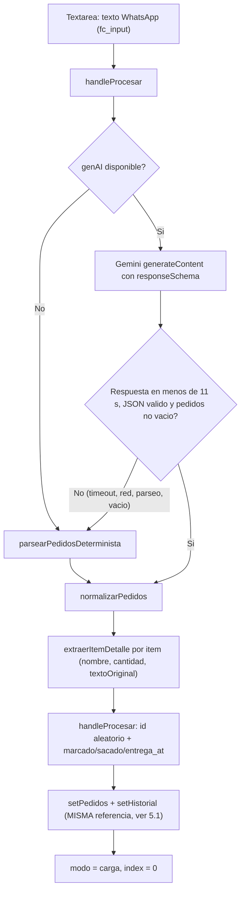
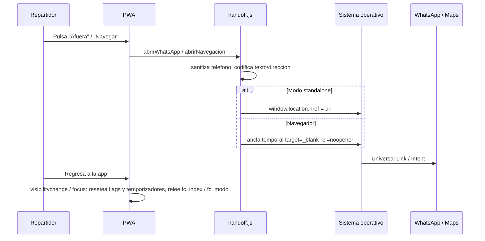

# Arquitectura y Auditoría Técnica del Sistema — App de Reparto Full Canapé

| Campo | Valor |
|---|---|
| Repositorio | `full-canape-reparto-web` (paquete npm `sistema-reparto@0.0.0`) |
| Rama / commit auditado | `main` @ `a902954` |
| Fecha de auditoría | 2026-10-14 |
| Destinatario | Modelo de razonamiento externo (revisión arquitectónica, optimización y simplificación) |
| Estado de build | `npm run lint`: 0 errores / 0 advertencias. `npm run build`: OK |
| Alcance | 100 % de `src/`, `public/` y configuración raíz. Se excluyen `node_modules/`, `dist/` y `.agents/` (skills de tooling, no forman parte del runtime) |

> Convención de este documento: toda afirmación sobre el código está verificada contra el commit indicado. Las secciones marcadas como **[NO VERIFICADO]** describen comportamiento que depende del dispositivo, del backend o de infraestructura que no está en el repositorio y que no pudo comprobarse en este entorno.

---

## 0. Índice

1. Resumen ejecutivo y stack tecnológico
2. Árbol de directorios y análisis por archivo
3. Flujo de datos y ciclo de vida operativo
4. Bitácora de errores resueltos frente a parches temporales (auditoría de transparencia)
5. Defectos latentes detectados durante esta auditoría (no reportados previamente)
6. Vector de oportunidades para la revisión arquitectónica
7. Anexos: contratos de datos, claves de almacenamiento, variables de entorno, métricas

---

## 1. Resumen ejecutivo y stack tecnológico

### 1.1 Propósito operativo

Aplicación web progresiva (PWA) de uso interno para los repartidores de Full Canapé (catering y cóctel, Santiago de Chile). El flujo de negocio es:

1. El repartidor pega en la app un bloque de texto copiado desde WhatsApp con los pedidos del día.
2. El texto se convierte en una ruta estructurada (paradas con horario, nombre de cliente, dirección, teléfono e ítems con cantidad), primero mediante Gemini con salida JSON estructurada y, si falla, mediante un parser determinista por expresiones regulares.
3. **Fase 1 — Check-in en cocina (`modo = 'carga'`)**: el repartidor marca cada ítem cargado en el vehículo. La ruta no puede iniciarse hasta que todos los ítems estén marcados.
4. **Fase 2 — En ruta (`modo = 'reparto'`)**: por cada parada se navega con Google Maps, se avisa al cliente por WhatsApp (mensajes predefinidos), se puede llamar directamente y se marcan los ítems entregados.
5. **Fase 3 — Fin (`modo = 'fin'`)**: pantalla de cierre, navegación de retorno a la base y reinicio.
6. En paralelo, el estado de la ruta se sincroniza con Supabase (`monitoreo_rutas`) para un **Radar Admin** oculto (acceso por pulsación prolongada) que muestra en vivo la parada actual de cada repartidor, y se emiten notificaciones push al administrador en hitos de la ruta.

### 1.2 Contexto de despliegue

| Aspecto | Detalle |
|---|---|
| Dispositivo objetivo | Teléfonos móviles (Android e iOS) montados en vehículos de reparto, instalados como PWA (`display: standalone`, `orientation: portrait`) |
| Condiciones de uso | Diurno, luz solar directa. Por requisito de negocio el sistema es **exclusivamente de tema claro** (sin modo oscuro) |
| Usuarios | 4 repartidores fijos (`Javi`, `Mora`, `Sala`, `Nico`) y 1 administrador |
| Hosting | Vercel (inferido por comentario en `src/lib/supabase.js`; no hay `vercel.json` en el repositorio) **[NO VERIFICADO]** |
| Backend | Supabase (proyecto `ouqvkmfjklgnkfaufcif`): PostgreSQL (tablas `monitoreo_rutas`, `push_subscriptions`) y una Edge Function `push-notify` que **no está en este repositorio** |
| IA | Google Gemini, invocado **directamente desde el navegador** con una clave expuesta en el bundle (ver sección 4.6) |

### 1.3 Inventario tecnológico (versiones instaladas, `npm ls --depth=0`)

| Capa | Paquete | Rango en `package.json` | Versión instalada | Observación |
|---|---|---|---|---|
| Lenguaje | JavaScript ES2020+ / JSX | — | — | Sin TypeScript. `@types/react*` instalados pero sin uso |
| UI | `react` | `^19.2.0` | 19.2.4 | Un único componente funcional raíz |
| UI | `react-dom` | `^19.2.0` | 19.2.4 | `createRoot` + `StrictMode` |
| Bundler | `vite` | `^8.0.0-beta.13` (+ `overrides`) | **8.0.0-beta.14** | Versión beta en producción (riesgo de estabilidad) |
| Bundler | `@vitejs/plugin-react` | `^5.1.1` | 5.1.4 | Configuración por defecto |
| Estilos | `tailwindcss` | `^4.1.18` | 4.1.18 | Tailwind v4 vía `@import "tailwindcss"` |
| Estilos | `@tailwindcss/postcss` | `^4.1.18` | 4.1.18 | Declarado en `dependencies` (debería ser `devDependencies`) |
| Estilos | `postcss` / `autoprefixer` | `^8.5.6` / `^10.4.24` | 8.5.6 / 10.4.24 | `autoprefixer` es redundante con Tailwind v4 |
| Backend SDK | `@supabase/supabase-js` | `^2.105.4` | 2.105.4 | Cliente anónimo, sin Auth |
| IA SDK | `@google/generative-ai` | `^0.24.1` | 0.24.1 | SDK heredado; Google recomienda migrar a `@google/genai` |
| Iconos | `lucide-react` | `^0.564.0` | 0.564.0 | Imports nombrados (tree-shaking efectivo) |
| Calidad | `eslint` 9 + `eslint-plugin-react-hooks` 7 + `eslint-plugin-react-refresh` | — | 9.39.2 / 7.0.1 / 0.4.26 | Flat config. Sin tests de ningún tipo |
| Extraños | `@emnapi/*`, `@napi-rs/wasm-runtime`, `@tybys/wasm-util` | — | — | Marcados `extraneous` por npm: residuos en `node_modules` |

Scripts: `dev` (`vite`), `build` (`vite build`), `lint` (`eslint .`), `preview` (`vite preview`). No existen scripts de test, typecheck ni formateo.

### 1.4 Métricas del artefacto de producción (último build)

| Artefacto | Tamaño | Gzip |
|---|---|---|
| `dist/index.html` | 0.92 kB | 0.42 kB |
| `dist/assets/index-*.css` | 34.93 kB | 7.42 kB |
| `dist/assets/index-*.js` | 253.81 kB | 77.11 kB |

Un único chunk JS: no hay code splitting. `@supabase/supabase-js` y `@google/generative-ai` se cargan en el arranque aunque solo se necesitan, respectivamente, tras cargar una ruta y al pulsar "Cargar ruta".

---

## 2. Árbol de directorios y análisis por archivo

### 2.1 Árbol completo (archivos versionados, excluyendo `.agents/`)

```
full-canape-reparto-web/
├── .gitignore                    27 líneas   Ignora node_modules, dist, *.local, .env
├── README.md                     ~16 líneas  Plantilla por defecto de Vite (sin documentación del proyecto)
├── eslint.config.js              42 líneas   Flat config: src/**/*.{js,jsx} (browser) + public/sw.js (serviceworker)
├── index.html                    21 líneas   Shell HTML, meta PWA, theme-color #f8fafc
├── package.json                  ~38 líneas
├── package-lock.json
├── postcss.config.js              6 líneas   @tailwindcss/postcss + autoprefixer
├── skills-lock.json                          Lock de skills de agentes (tooling, no runtime)
├── tailwind.config.js            11 líneas   CÓDIGO MUERTO: config estilo v3, Tailwind v4 no lo lee sin @config
├── vite.config.js                 7 líneas   Solo plugin react()
├── public/
│   ├── apple-touch-icon.png      501x501 px, 108 kB  Usado como favicon, icono PWA y badge push
│   ├── logo.png                  501x501 px,  87 kB  Logo de la pantalla de inicio
│   ├── manifest.json             22 líneas   Manifiesto PWA
│   ├── sw.js                     75 líneas   Service Worker: solo push + notificationclick (sin caché)
│   └── vite.svg                              CÓDIGO MUERTO (no referenciado)
└── src/
    ├── main.jsx                  10 líneas   Punto de entrada: createRoot + StrictMode
    ├── App.jsx                 1651 líneas   Monolito: todo el estado, lógica y UI
    ├── App.css                    0 líneas   CÓDIGO MUERTO (vacío, no importado)
    ├── index.css                131 líneas   Tailwind v4 + design system de tema claro
    ├── productos.json             9 líneas   CÓDIGO MUERTO (catálogo de 32 productos, no importado)
    ├── assets/
    │   └── react.svg                         CÓDIGO MUERTO (no referenciado)
    └── lib/
        ├── gemini.js            364 líneas   Ingesta: esquema, prompt, Gemini, parser determinista, normalización
        ├── handoff.js            71 líneas   Deep links WhatsApp / Maps, háptica
        ├── push.js              157 líneas   Registro SW, permisos, suscripción VAPID, disparo push
        ├── sanitizer.js          78 líneas   Normalización de teléfonos móviles chilenos
        └── supabase.js            8 líneas   Cliente Supabase con degradación a null
```

Total de código fuente propio en runtime: aproximadamente 2 560 líneas, de las cuales el 64 % está en `src/App.jsx`.

### 2.2 `src/main.jsx` (10 líneas)

Monta `<App />` dentro de `<StrictMode>` sobre `#root` e importa `index.css`. Relevante: `StrictMode` duplica en desarrollo la ejecución de funciones actualizadoras de estado, lo que expone el defecto 5.3.

### 2.3 `src/App.jsx` (1651 líneas) — componente monolítico

#### 2.3.1 Constantes y utilidades de módulo (líneas 1–37)

| Símbolo | Línea | Función |
|---|---|---|
| `REPARTIDORES` | 20 | `['Javi', 'Mora', 'Sala', 'Nico']` codificado en el cliente |
| `getMemoria(clave, def)` | 22 | `JSON.parse(localStorage.getItem(clave))` con fallback ante excepción |
| `guardarMemoria(clave, valor)` | 31 | `localStorage.setItem(clave, JSON.stringify(valor))` con captura silenciosa de cuota |

#### 2.3.2 Inventario de estado (31 `useState`, 7 `useRef`, 6 `useEffect`, 1 `useCallback`, 0 `useMemo`)

| Dominio | Estado | Persistido en `localStorage` | Propósito |
|---|---|---|---|
| Identidad | `repartidorNombre` | `fc_repartidor_nombre` | Nombre del conductor seleccionado |
| Identidad | `modalSelectorRepartidor` | — (derivado al montar) | Visibilidad del selector de conductor |
| Identidad | `sessionId` (estado de solo lectura) | `fc_session_id` | `'rep_' + Math.random()...`; clave primaria en `monitoreo_rutas` |
| Ingesta | `input` | `fc_input` | Texto crudo de WhatsApp |
| Ingesta | `cargando` | — | Spinner durante el parseo |
| Ruta | `pedidos` | `fc_pedidos` | Arreglo de paradas (fuente de verdad de la ruta) |
| Ruta | `historial` | `fc_historial` | Copia de la última ruta cargada para "Restaurar" |
| Ruta | `index` | `fc_index` | Parada activa |
| Ruta | `modo` | `fc_modo` | `'carga' \| 'reparto' \| 'fin'` (máquina de estados implícita) |
| Ruta | `eta` | `fc_eta` | Minutos estimados para el mensaje de salida |
| Interacción | `presionando`, `absorbiendo`, `slideVisible`, `animatingMover` | — | Animaciones: botón "TODO", transición de fin, cambio de tarjeta, reordenamiento |
| Interacción | `resetProgress`, `editProgress`, `adminProgress`, `hideProgress` | — | Barras de progreso de cuatro gestos de pulsación prolongada distintos |
| Modales | `showReorder`, `alertaSinTelefono`, `modalEditId`, `modalEditPhone`, `modoEdicion`, `formEdicion` | — | Cola de reparto, teléfonos faltantes, edición de parada |
| Admin | `showAdmin`, `rutasEnVivo`, `loadingAdmin`, `adminError`, `expandedAdminId` | — | Radar Admin |
| Admin | `hiddenRutas` | `fc_hidden_rutas` | Mapa `{ id: timestampOcultado }` para ocultar repartidores del radar |
| Push | `pushEstado` | — | `'idle' \| 'requesting' \| 'granted' \| 'denied' \| 'unsupported'` |

Refs: `pressTimer`, `resetTimer`, `editTimer`, `hideTimer`, `adminTimer`, `syncTimeoutRef` (temporizadores) y `pushInicializado` (guarda de ejecución única).

Valores derivados calculados en cada render (líneas 618–637, sin memoización): `todoCargado`, `totalCajasRuta`, `cajasCargadas`, `pedidoActual`, `bultosParadaActual`, `bultosEntregadosParada`.

#### 2.3.3 Efectos

| Línea | Efecto | Dependencias | Observación |
|---|---|---|---|
| 112 | Limpieza de los 6 temporizadores al desmontar | `[]` | Correcto |
| 124 | Persistencia de 7 claves en `localStorage` | 7 estados | Reescribe **las 7 claves** ante cualquier cambio de cualquiera de ellas, incluido `pedidos` completo serializado en cada pulsación de checkbox |
| 135 | Registro del Service Worker y lectura del permiso de notificaciones | `[]` + guarda por ref | Correcto |
| 150 | Transición de tarjeta al cambiar `index` (respeta `prefers-reduced-motion`) | `[index]` | Correcto |
| 159 | Restauración al volver de segundo plano (`visibilitychange` + `focus`) | `[index, modo]` | Ver 4.2: parcialmente redundante |
| 232 | Sincronización con Supabase con debounce de 600 ms | `[sincronizarConNube]` | Se dispara con cada cambio de `pedidos`, `index`, `modo` o `repartidorNombre` |

#### 2.3.4 Manejadores (orden de declaración)

| Línea | Manejador | Responsabilidad |
|---|---|---|
| 104 | `seleccionarRepartidor` | Persiste identidad y cierra el selector |
| 191 | `sincronizarConNube` | Upsert en `monitoreo_rutas` con timeout de 6 s y reintento sin `direccion_actual` |
| 244 | `cargarRutasEnVivo` | Lectura del radar: últimas 48 h, `esta_activo = true`, límite 20, deduplicación por `nombre_repartidor` |
| 298 | `limpiarRadar` | Vacía el radar local |
| 306 / 320 | `startAdmin` / `stopAdmin` | Pulsación prolongada (800 ms) para abrir el radar |
| 322 / 337 | `startHide` / `stopHide` | Pulsación prolongada para ocultar un repartidor del radar |
| 342 | `handleProcesar` | Llama a `procesarPedidos`, normaliza ítems con `extraerItemDetalle`, asigna IDs, inicializa la ruta |
| 380 | `restaurarUltima` | Clona profundamente `historial` hacia `pedidos` |
| 389 | `activarPush` | Solicitud de permiso y suscripción VAPID |
| 404 / 417 / 419 | `startReset` / `stopReset` / `limpiarTodo` | Reinicio de la ruta (pulsación prolongada) |
| 424 / 431 | `moverPedido` / `moverPedidoConAnimacion` | Reordenamiento de paradas con animación de 280 ms |
| 442 | `pedirTelefonoAdmin` | WhatsApp al administrador solicitando el teléfono de una parada |
| 449 | `intentarComenzarRuta` | Valida teléfonos faltantes antes de pasar a reparto |
| 459 | `guardarTelefonoModal` | Guarda un teléfono desde el modal multicontrol |
| 477 / 497 / 502 | `startEditPress` / `stopEditPress` / `guardarEdicion` | Edición de parada (horario, nombre, teléfono, dirección) |
| 517–545 | `enviarAvisoCliente`, `enviarMensajeTrafico`, `enviarMensajeAfuera`, `enviarMensajeRecepcion`, `abrirChatVacio` | Mensajes predefinidos de WhatsApp |
| 547 | `llamarCliente` | `window.location.href = 'tel:+...'` |
| 553 | `avisarAdmin` | WhatsApp de progreso al administrador |
| 562 | `finalizarRuta` | Push de ruta completada y transición a `modo = 'fin'` |
| 573 | `toggleCaja` | Alterna `marcado` (carga) o `sacado` + `entrega_at` (reparto) |
| 585 | `cambiarAModoReparto` | Paso a reparto y push de inicio de ruta |
| 596 | `avanzar` | Avanza parada y emite push de parada entregada (solo en reparto) |
| 613 | `retroceder` | Retrocede parada |

Número de administrador codificado dos veces: `"56988589058"` (líneas 443 y 554). Dirección de retorno codificada: `"fundo el bosque 95, maipú"`.

#### 2.3.5 Subcomponentes declarados dentro del cuerpo de `App`

| Línea | Componente | Problema |
|---|---|---|
| 639 | `BotonRayo` | Botón de pulsación prolongada "TODO" (marca todos los ítems) |
| 678 | `BotonPrincipalAccion` | CTA "Comenzar ruta" / "Entregado — siguiente" / "Terminar ruta" |
| 719 | `ModalSelectorRepartidorComponent` | Selector de conductor |

Los tres se redefinen en cada render de `App`, por lo que React los trata como un tipo de componente nuevo y **desmonta y vuelve a montar su DOM en cada render**. Ver defecto 5.4.

#### 2.3.6 Árbol de renderizado (retornos tempranos condicionales)

```
App
├── if (showAdmin)            → Pantalla Radar Admin (línea 766)
│     ├── Encabezado + cerrar
│     ├── Botón "Actualizar radar"
│     ├── Error de radar
│     └── Lista de tarjetas por repartidor (acordeón con paradas, hora de entrega, ocultar por pulsación prolongada)
├── if (modo === 'fin')       → Pantalla Ruta Completada (línea 972)
│     ├── <style> con keyframes inyectados en línea
│     ├── 40 piezas de confeti con Math.random() en render
│     └── "Vamos a casa" / "Volver al inicio"
├── if (pedidos.length === 0) → Pantalla de Ingesta (línea 1043)
│     ├── Selector de conductor (modal) + acceso admin oculto
│     ├── Textarea de pedidos
│     └── Cargar ruta / Restaurar última carga / Activar alertas push
└── default                    → Pantalla Operativa (línea 1150)
      ├── <style> con keyframes "jiggle" inyectados en línea
      ├── Modal selector de conductor
      ├── Overlay de absorción (transición a fin)
      ├── Modal multicontrol de teléfonos faltantes
      ├── Barra superior: Reiniciar (pulsación prolongada), conductor, Cola
      ├── Modal Cola de reparto (reordenamiento)
      ├── Selector de fase: 1 · CHECK-IN / 2 · EN RUTA
      └── Tarjeta principal (grid 1 col móvil / 2 col desktop)
            ├── Columna izquierda
            │     ├── Badge total cajas (solo carga)
            │     ├── Navegación de paradas (anterior / N de M / siguiente)
            │     ├── Modo edición o: horario + teléfono + BotonRayo, nombre de cliente (condicional), dirección
            │     └── Solo reparto: Navegar con Maps, ETA + Avisar salida/Pedir teléfono,
            │         respuestas rápidas (grid 4 col), Llamar directo, Informar admin
            └── Columna derecha
                  ├── Badge bultos de la parada (solo reparto)
                  ├── Checklist de ítems (label + checkbox)
                  └── BotonPrincipalAccion
```

### 2.4 `src/lib/gemini.js` (364 líneas) — pipeline de ingesta

| Símbolo | Línea | Responsabilidad |
|---|---|---|
| `apiKey` / `genAI` | 4–5 | `import.meta.env?.VITE_GEMINI_API_KEY`; si falta, `genAI = null` y se usa solo el parser determinista |
| `schemaPedidos` | 8 | Esquema `responseSchema`: `pedidos[]` con `cliente` (horario), `nombre_cliente`, `telefono`, `direccion`, `items[]` con `{ nombre, cantidad: INTEGER, textoOriginal }` |
| `extraerItemDetalle(item)` | 67 | Normaliza un ítem string u objeto a `{ nombre, cantidad, textoOriginal }`. Regex de prefijo de cantidad: `^(\d+)\s*(?:[-–—*.]\|[xX]\s*\|(cajas?\|unidades?\|...)\s*(de\s+)?\|\s+)\s*(.+)$`. Sin prefijo, `cantidad = 1`. Para objetos sin prefijo visible y `cantidad > 1`, antepone `"{n}x "` al nombre |
| `parsearPedidosDeterminista(texto)` | 120 | Fallback sin red (ver 3.1.3) |
| `procesarPedidos(texto)` | 272 | Orquestador: prompt + modelo `gemini-3.5-flash`, `temperature: 0.1`, `responseMimeType: 'application/json'`, timeout de 11 s por `Promise.race` con `clearTimeout` en `finally`, validación de arreglo no vacío y fallback ante cualquier excepción |
| `normalizarPedidos(data)` | 346 | Aplica valores por defecto (`'Sin horario'`, `'Sin dirección'`, `['1 pedido']`), recorta `nombre_cliente`, sanitiza teléfono y pasa cada ítem por `extraerItemDetalle` |

Notas:
- El timeout de `Promise.race` **no cancela** la petición HTTP subyacente; solo deja de esperarla.
- La validez del identificador de modelo `gemini-3.5-flash` fue indicada por el usuario; en este entorno no hay clave configurada, por lo que **no se ha ejecutado ninguna llamada real a Gemini** **[NO VERIFICADO]**. Si el identificador fuese inválido, el sistema degradaría silenciosamente al parser determinista en cada carga (solo visible en consola).
- `extraerItemDetalle` se aplica dos veces sobre cada ítem (en `normalizarPedidos` y otra vez en `handleProcesar`). Es idempotente, pero redundante.

### 2.5 `src/lib/sanitizer.js` (78 líneas)

`sanitizarTelefonoChileno(raw)` produce el formato canónico `569XXXXXXXX` (11 dígitos) requerido por `wa.me`:

| Paso | Regla |
|---|---|
| 1 | Elimina todo carácter no numérico |
| 2 | `0056…` → `56…`; un `0` inicial se descarta |
| 3 | Colapsa prefijos duplicados `5656…` |
| 4 | Con prefijo `56`: acepta `56 + 9 + 8 dígitos`; `56 + 8 dígitos` → `569…`; `5699 + 8` → `569…`; si no, busca la subsecuencia `9\d{8}` |
| 5 | Sin prefijo: 9 dígitos que empiezan con `9` → `56…`; 8 dígitos → `569…` |
| 6 | Último recurso: busca `569\d{8}` o `9\d{8}` en cadenas largas; si nada coincide, **devuelve los dígitos sin validar** |

`formatearTelefonoVisual(phone)` → `+56 9 XXXX XXXX`. El paso 6 implica que un número fijo o extranjero se propaga como "válido" y produce un enlace `wa.me` incorrecto en lugar de un error explícito.

### 2.6 `src/lib/handoff.js` (71 líneas)

| Símbolo | Comportamiento |
|---|---|
| `dispararHaptico(ms)` | `navigator.vibrate` protegido con try/catch (sin efecto en iOS, que no implementa la API) |
| `abrirHandoffExterno(url)` | Si la app corre en modo standalone (`navigator.standalone` o `display-mode: standalone`): `window.location.href = url`. En navegador normal: crea un `<a target="_blank" rel="noopener noreferrer">`, lo pulsa y lo elimina a los 150 ms |
| `abrirWhatsApp({ telefono, mensaje })` | Sanitiza y abre `https://wa.me/{tel}?text={encodeURIComponent(mensaje)}`. Devuelve `false` si el teléfono queda vacío |
| `abrirNavegacion(direccion)` | `https://www.google.com/maps/dir/?api=1&destination={encodeURIComponent(direccion)}` |

### 2.7 `src/lib/supabase.js` (8 líneas)

Crea el cliente con `VITE_SUPABASE_URL` y `VITE_SUPABASE_ANON_KEY`. Si alguna falta, exporta `null`, y todos los consumidores comprueban `if (!supabase)`. Sin sesión de usuario, sin Auth y sin Realtime: el radar es por consulta manual ("Actualizar radar"), no por suscripción.

### 2.8 `src/lib/push.js` (157 líneas)

| Función | Comportamiento |
|---|---|
| `pushEsSoportado()` | `serviceWorker in navigator && PushManager in window && Notification in window` |
| `registrarServiceWorker()` | `navigator.serviceWorker.register('/sw.js', { scope: '/' })` |
| `solicitarPermisoPush()` | `Notification.requestPermission()` |
| `suscribirAdmin()` | Requiere `VITE_VAPID_PUBLIC_KEY`; `pushManager.subscribe({ userVisibleOnly: true, applicationServerKey })`; upsert en `push_subscriptions` con `onConflict: 'endpoint'` |
| `dispararNotificacionPush(titulo, cuerpo)` | Sin Supabase o sin VAPID: `new Notification(...)` **local en el dispositivo del repartidor**. Con ambos: `supabase.functions.invoke('push-notify', { body: { titulo, cuerpo } })` |

Contiene 15 llamadas a `console.*` con emojis en los mensajes, que contradicen la política sin emojis del proyecto (solo afecta a la consola). Ver defectos 5.2 y 5.5.

### 2.9 `public/sw.js` (75 líneas)

- `install`: `skipWaiting()`; `activate`: `clients.claim()`.
- `push`: combina el payload JSON (`titulo`, `cuerpo`, `icono`, `badge`, `url`) con valores por defecto; `tag: 'fc-ruta-update'` con `renotify: true` (cada push reemplaza al anterior en la bandeja), `vibrate: [100, 50, 200]`.
- `notificationclick`: enfoca una ventana existente del mismo origen o abre `url`.
- **No hay manejador `fetch` ni caché**: la app no funciona sin conexión, ni siquiera para cargar el shell. Cualquier descripción previa de capacidad "offline" se refiere exclusivamente a la persistencia del estado en `localStorage` una vez cargada la página.

### 2.10 `public/manifest.json` (22 líneas) e `index.html` (21 líneas)

- `theme_color` y `background_color`: `#f8fafc` (tema claro). `meta theme-color` coherente.
- Los dos iconos declarados (`192x192` y `512x512`) apuntan al mismo `apple-touch-icon.png`, cuyas dimensiones reales son **501x501**. No hay icono `maskable`. Chrome puede rechazar los iconos para el instalador o reescalarlos.
- `viewport` con `maximum-scale=1.0, user-scalable=no`: impide el zoom (decisión de UX para cabina, contraria a WCAG 1.4.4).
- `apple-mobile-web-app-capable` presente.

### 2.11 `src/index.css` (131 líneas)

- `@source not "../ARQUITECTURA_Y_AUDITORIA_SISTEMA.md"`: excluye este documento del escaneo automático de Tailwind v4, que de lo contrario generaría CSS para las clases citadas aquí (+1.06 kB medido).
- `@import` de Google Fonts (Montserrat 500–900) **antes** de Tailwind: petición externa bloqueante para el render y sin caché offline.
- Capa `base`: fondo `#f8fafc`, texto `#0f172a`, `padding` con `env(safe-area-inset-*)` aplicado sobre `html`. Los contenedores de `App.jsx` vuelven a aplicar `max(1rem, env(safe-area-inset-*))`, por lo que **el safe area se suma dos veces** en dispositivos con muesca.
- Capa `components`: `.shadow-card`, `.shadow-cta`, `.shadow-wa`, `.shadow-emerald`, `.card-accent-top`.
- Capa `utilities`: `animate-slide-up`, `animate-pop-in`, `animate-fade-in`, `animate-pulse-dot`.
- Anillo de foco rojo de 3 px para accesibilidad de teclado.

---

## 3. Flujo de datos y ciclo de vida operativo

### 3.1 Ingesta



#### 3.1.1 Ruta Gemini

El prompt (líneas 278–295) define seis reglas: separación por día/horario, `cliente` = horario, `nombre_cliente`, dirección, teléfono e ítems como objetos con `cantidad` entera. La salida se restringe por `responseSchema`. El texto del usuario se interpola sin delimitadores dentro del prompt (riesgo menor de inyección de prompt, irrelevante en un contexto de uso interno).

#### 3.1.2 Contrato de salida normalizado

```json
{
  "pedidos": [
    {
      "cliente": "Sábado 18. 08:00 a 09:00",
      "nombre_cliente": "Josefina Bilbao",
      "telefono": "56988589058",
      "direccion": "Rafael de Sanzio 6811, La Reina",
      "items": [
        { "nombre": "3-croissant", "cantidad": 3, "textoOriginal": "3-croissant" }
      ]
    }
  ]
}
```

En el estado de React cada ítem se amplía con `marcado: boolean`, `sacado: boolean` y `entrega_at: string | null` (`HH:MM` local), y cada parada con `id` (7 caracteres aleatorios).

#### 3.1.3 Parser determinista (heurística línea a línea)

1. Divide en líneas no vacías.
2. Segmenta en bloques: abre bloque nuevo cuando una línea es inicio de pedido (día de la semana al inicio, patrón de hora `\d{1,2}[:.]\d{2}` en una línea que no contiene "canap", o `pedido #N`).
3. Por bloque: si la primera línea es inicio de pedido, se toma como horario. Para el resto, en este orden de prioridad:
   - descarta anotaciones "sin teléfono";
   - etiquetas explícitas `Cliente:` / `Nombre:` / `Contacto:` y `Dirección:` / `Dir:` / `Destino:`;
   - teléfono (8–13 dígitos con prefijo 56/9/+56 o indicador `tel`, `fono`, `wsp`...); solo se conserva el primero;
   - ítem (prefijo numérico con separador, unidad, o palabra clave de catálogo: canapé, croissant, brocheta, canasto, quiche, empanada, postre, tabla, bollo, dulce, crostini, bocado, churrasco, frica, picoteo, mil hojas, camarón, tapado, sandwich);
   - dirección (palabra clave vial, una de 29 comunas, o patrón "palabras + número de 2–5 dígitos"); solo la primera;
   - nombre de persona (solo letras, 3–50 caracteres, 1–5 palabras, que no encaje en ninguna categoría anterior); solo el primero;
   - si aún no hay dirección, la línea se toma como dirección; si ya la hay, como ítem.

Casos verificados con ejecución real sobre el commit auditado:

| Entrada | `nombre_cliente` | `direccion` | Bultos |
|---|---|---|---|
| 5 líneas de ítems (1+2+3+1+2) | `""` (se omite en la UI) | `Sin dirección` | 9 |
| `Josefina Bilbao` + 5 ítems | `Josefina Bilbao` | `Sin dirección` | 9 |
| Horario + nombre + dirección + teléfono + 5 ítems | `Josefina Bilbao` | `Rafael de Sanzio 6811, La Reina` | 9 |
| Horario + dirección + nombre + teléfono + 5 ítems | `Josefina Bilbao` | `Rafael de Sanzio 6811, La Reina` | 9 |
| Dos bloques con horario | 2 paradas correctamente separadas | — | 9 y 2 |

### 3.2 Normalización de cantidades y cálculo de bultos

```
cantidad(item)      = Number(item.cantidad) || 1
totalCajasRuta      = Σ paradas Σ items cantidad
cajasCargadas       = Σ paradas Σ items[marcado] cantidad
bultosParadaActual  = Σ items(pedidoActual) cantidad
bultosEntregados    = Σ items(pedidoActual)[sacado] cantidad
```

Se muestran en el badge de check-in ("Total cajas a cargar: N cajas — X/N marcadas") y en el badge de reparto ("Bultos parada: N cajas — X/N entregadas"). El checklist muestra `item.nombre` con el prefijo de cantidad intacto (por ejemplo `3-croissant`). El check es por línea, no por unidad: no se puede representar una carga parcial (2 de 3 croissants).

### 3.3 Persistencia

#### 3.3.1 Local (`localStorage`)

| Clave | Tipo | Escritura | Borrado en `limpiarTodo` |
|---|---|---|---|
| `fc_repartidor_nombre` | string | `seleccionarRepartidor` | No |
| `fc_session_id` | string | Primer montaje | No |
| `fc_input` | string | Efecto de persistencia | Sí |
| `fc_pedidos` | `Pedido[]` | Efecto de persistencia | Sí |
| `fc_historial` | `Pedido[] \| null` | Efecto de persistencia | No (intencional, permite restaurar) |
| `fc_index` | number | Efecto de persistencia | Sí |
| `fc_modo` | string | Efecto de persistencia | Sí |
| `fc_eta` | string | Efecto de persistencia | Sí |
| `fc_hidden_rutas` | `Record<id, number>` | Efecto de persistencia | No |

Las escrituras son síncronas sobre el hilo principal y serializan `pedidos` e `historial` completos en cada cambio de cualquiera de los 7 estados persistidos. No hay versión de esquema: un cambio en la forma de `Pedido` (como el reciente paso de `items: string[]` a objetos con `cantidad`) no migra los datos ya guardados. Las rutas previas a ese cambio se muestran con `cantidad` indefinida, que el cálculo convierte en 1 por el `|| 1`.

#### 3.3.2 Nube (Supabase `monitoreo_rutas`)

Upsert con debounce de 600 ms y timeout de 6 s:

| Columna | Valor |
|---|---|
| `id` | `sessionId` |
| `nombre_repartidor` | `repartidorNombre` o `"Repartidor XXXXX"` |
| `progreso_actual` | `index` |
| `total_pedidos` | `pedidos.length` |
| `pedidos_json` | Arreglo completo de paradas (incluye nombres, teléfonos y direcciones de clientes) |
| `ultima_actualizacion` | ISO timestamp |
| `esta_activo` | `modo !== 'fin'` |
| `direccion_actual` | Dirección de la parada activa; si el servidor responde con un error que menciona la columna, se reintenta sin ella |

Lectura del radar: `select` de 7 columnas, `ultima_actualizacion >= ahora - 48 h`, `esta_activo = true`, orden descendente, límite 20, deduplicación en cliente por `nombre_repartidor` (conserva la fila más reciente). Una ruta se marca como desactualizada si no se actualiza en 12 h.

Diferencias de nomenclatura: el requerimiento original pedía `repartidor_nombre`, `indice_actual`, `total_paradas` y `estado`; la tabla real usa `nombre_repartidor`, `progreso_actual`, `total_pedidos` y `esta_activo`. El código usa los nombres reales de la tabla.

Las políticas RLS de `monitoreo_rutas` y `push_subscriptions` no están versionadas en el repositorio (no hay carpeta `supabase/` ni migraciones) **[NO VERIFICADO]**. Como el cliente usa la clave anónima sin autenticación, cualquier persona con la URL del despliegue puede, en principio, leer `pedidos_json` (datos personales de clientes) y escribir filas arbitrarias, salvo que RLS lo impida en el servidor.

### 3.4 Handoffs externos



Llamadas: `tel:+569...` mediante `window.location.href`.

---

## 4. Bitácora de errores resueltos frente a parches temporales

Clasificación usada:
- **Resuelto en la causa raíz**: se corrigió el mecanismo que producía el error.
- **Mitigado**: se redujo el síntoma o se añadió una defensa, pero la causa raíz persiste o no está verificada.
- **Diferido**: se conoce y no se ha abordado.

### 4.1 Conteo de bultos (longitud del arreglo frente a suma de cantidades) — Resuelto en la causa raíz

- **Síntoma**: con `1-Canasto / 2-canapé mix 3 / 3-croissant / 1-brocheta / 2-canastos dulces` la UI mostraba 5 cajas en lugar de 9, y el checklist perdía el prefijo de cantidad.
- **Causa raíz**: `items` era `string[]`; los totales usaban `items.length`; no existía el concepto de cantidad en el modelo.
- **Corrección** (commit `a902954`): modelo `{ nombre, cantidad, textoOriginal }` en esquema, prompt, parser determinista y `normalizarPedidos`; totales calculados por suma de `cantidad`; checklist con el nombre original intacto.
- **Riesgos residuales**:
  - Ambigüedad semántica: `50 canapés` se cuenta como 50 bultos aunque represente 50 unidades dentro de una sola caja. El sistema no distingue cajas de unidades.
  - `extraerItemDetalle` acepta un número seguido de espacio como prefijo; una línea como `2025 pedido especial` se interpretaría como 2025 bultos.
  - Datos persistidos antes del cambio no se migran (ver 3.3.1).

### 4.2 Pantalla en blanco con botón "X" al volver de WhatsApp o Maps — Mitigado, no verificado en dispositivo

- **Síntoma**: tras abrir WhatsApp o Maps desde la PWA, al regresar quedaba una vista blanca con un botón "X".
- **Causa raíz probable**: `window.open(url, '_blank')` en modo standalone crea en iOS una vista de navegador in-app (SFSafariViewController) que queda huérfana al saltar a la app nativa.
- **Corrección aplicada**: centralización en `handoff.js`; en standalone se usa `location.href`, en navegador un ancla con `noopener`. Listener `visibilitychange`/`focus` que limpia flags de UI y temporizadores.
- **Transparencia**:
  - No se ha validado en dispositivos físicos iOS y Android **[NO VERIFICADO]**.
  - En Android standalone, `location.href = 'https://wa.me/...'` navega la propia ventana de la PWA hacia `wa.me`. Si el intent hacia WhatsApp no se resuelve automáticamente, al volver el repartidor puede encontrar la página de `wa.me` dentro de la PWA en lugar de la app. Una alternativa más robusta es probar con `whatsapp://send?phone=...&text=...` con fallback, o usar `intent://` en Android.
  - La relectura de `fc_index` y `fc_modo` desde `localStorage` en el listener es prácticamente un no-op: el efecto de persistencia escribe esos mismos valores desde el estado, así que nunca difieren. Es un parche defensivo que no aborda la causa.
  - El listener ejecuta `setCargando(false)`: si el repartidor cambia de app mientras Gemini procesa (hasta 11 s), el spinner desaparece aunque la petición sigue en curso, y la ruta aparece de golpe al terminar.

### 4.3 Notificaciones push accidentales durante el check-in en cocina — Resuelto

- **Síntoma**: al navegar entre paradas en la fase de carga se enviaban pushes de "parada entregada".
- **Corrección**: `avanzar` solo emite push si `modo === 'reparto'`.
- **Transparencia**: la emisión se realiza dentro de la función actualizadora de `setIndex` (efecto secundario dentro de un updater). En desarrollo con `StrictMode` el updater se ejecuta dos veces y se emiten dos pushes. En producción no se duplica, pero el patrón es incorrecto (ver 5.3).

### 4.4 Texto truncado en botones de respuesta rápida — Resuelto

- **Síntoma**: "Recepción" aparecía como "Recepciór..." y se superponía con "Chat".
- **Corrección**: `grid grid-cols-4 gap-1.5`, `px-1 py-2`, `text-[11px] sm:text-xs font-bold`, `whitespace-nowrap`, `min-w-0`.
- **Transparencia**: no se ha medido con capturas reales en 360 px. Con `whitespace-nowrap` y `min-w-0`, si la fuente Montserrat no cargase y el sistema usase una fuente más ancha, el texto podría desbordar el botón en lugar de truncarse. No hay prueba visual automatizada.

### 4.5 Visibilidad bajo luz solar (tema claro obligatorio) — Resuelto

- **Corrección**: eliminación de todas las superficies oscuras; fondos `#f8fafc`/`#f1f5f9`, tarjetas blancas con borde `slate-200/300`, texto `slate-900/700/500`, acentos `red-600`, `emerald-600`, `amber-600`; `theme-color` claro en `index.html` y `manifest.json`.
- **Residuos**: los overlays de modal usan `bg-slate-900/40` y `bg-slate-600/30` con `backdrop-blur` (velo translúcido, no superficie oscura). No se ha hecho una medición formal de contraste WCAG con herramienta. `text-slate-400` se usa en algunos textos secundarios (ratio aproximado de 2.6:1 sobre blanco, por debajo de AA 4.5:1).

### 4.6 Deuda estructural diferida (registro explícito)

| Ítem | Estado | Detalle |
|---|---|---|
| `App.jsx` monolítico (1651 líneas, 31 estados) | Diferido | Sin separación por dominio, sin contexto, sin reducer |
| Cola offline (IndexedDB / Background Sync) | Diferido | Si la sincronización falla, se descarta silenciosamente y solo se reintenta en el siguiente cambio de estado. No hay cola persistente |
| Service Worker sin caché | Diferido | La app no abre sin red |
| Clave de Gemini en el cliente | Diferido, riesgo de seguridad | No está codificada en el código fuente (se lee de `VITE_GEMINI_API_KEY`), pero toda variable `VITE_*` se incrusta en el bundle público. Cualquiera puede extraerla de `dist/assets/*.js` en producción. Debe moverse a una Edge Function de Supabase |
| Clave anónima de Supabase sin Auth | Diferido | Aceptable solo con RLS estricto, que no está versionado |
| Edge Function `push-notify` | Fuera del repositorio | No hay código ni contrato versionado; no se puede auditar |
| Tests | Inexistentes | Ni unitarios (parser, sanitizador), ni de componentes, ni E2E |
| TypeScript | No adoptado | Los contratos de datos solo existen implícitamente |
| Vite 8 beta | Diferido | Con `overrides` forzado |
| Datos de negocio codificados | Diferido | Repartidores, teléfono del administrador, dirección de base, textos de WhatsApp |
| Migración del SDK de Gemini | Diferido | `@google/generative-ai` es el SDK heredado |

---

## 5. Defectos latentes detectados durante esta auditoría

Ninguno de estos defectos había sido reportado. Ninguno se ha corregido en esta pasada (la tarea es documental). Ordenados por severidad.

### 5.1 [Alta] Mutación de estado compartida entre `pedidos` e `historial`

`handleProcesar` ejecuta `setHistorial(nuevosPedidos); setPedidos(nuevosPedidos);` con **la misma referencia**. Después, `toggleCaja`, `BotonRayo` y `guardarTelefonoModal` hacen copias superficiales (`[...pedidos]`) y **mutan los objetos anidados** (`n[index].items[i].marcado = ...`, `nuevos[idx].telefono = ...`, `forEach(it => it.sacado = true)`).

Consecuencias:
- Dentro de la misma sesión (sin recargar), `historial` acumula las marcas de carga y entrega. "Restaurar última carga" restauraría una ruta con ítems ya marcados. Tras recargar la página no ocurre, porque cada clave se deserializa por separado.
- La mutación directa rompe la semántica de inmutabilidad de React; funciona hoy solo porque el arreglo exterior es nuevo.

Corrección sugerida: `setHistorial(structuredClone(nuevosPedidos))` y actualizaciones inmutables (`map` anidado) o un reducer.

### 5.2 [Alta] `new Notification()` y `Notification.permission` sin protección en `dispararNotificacionPush`

Cuando falta Supabase o la clave VAPID, se ejecuta `if (Notification.permission === 'granted') new Notification(...)` fuera de cualquier try/catch:
- En **Chrome para Android**, el constructor `new Notification()` lanza `TypeError: Illegal constructor` (en Android solo se permite `registration.showNotification`).
- En **Safari iOS fuera de la PWA instalada**, `Notification` no existe y el acceso lanza `ReferenceError`.

Como `dispararNotificacionPush` es `async` y se llama sin `await` ni `.catch` desde `avanzar`, `cambiarAModoReparto` y `finalizarRuta`, el resultado es una **promesa rechazada no gestionada**. No interrumpe la UI, pero contamina la consola y oculta fallos reales. Además, el fallback local notifica en el teléfono del propio repartidor, no al administrador.

### 5.3 [Media] Efecto secundario dentro de un actualizador de estado

`avanzar` llama a `dispararNotificacionPush` dentro de `setIndex(i => { ...; return siguiente; })`. Los updaters deben ser puros; React puede ejecutarlos más de una vez (siempre en `StrictMode` en desarrollo). Corrección: calcular `siguiente` a partir de `index` fuera del updater y emitir el push después.

### 5.4 [Media] Componentes declarados dentro del render

`BotonRayo`, `BotonPrincipalAccion` y `ModalSelectorRepartidorComponent` se crean en cada render de `App`. React los trata como tipos nuevos y **desmonta y monta su DOM en cada render**. En `BotonRayo`, `onPointerDown` llama a `setPresionando(true)`, lo que provoca un render que reemplaza el `<button>` bajo el dedo del usuario mientras mantiene presionado. Los eventos `pointerup`/`pointerleave` posteriores pueden no llegar al nuevo nodo. Funciona porque el temporizador vive en un ref, pero la barra de progreso y la cancelación al soltar son frágiles. Además se pierde el foco de teclado y cualquier estado interno.

Corrección: extraerlos a componentes de nivel de módulo con props.

### 5.5 [Media] Cancelación incompleta de peticiones

- `procesarPedidos`: el timeout no aborta el `fetch` de Gemini.
- `sincronizarConNube` y `cargarRutasEnVivo`: si se lanza una excepción antes de `clearTimeout(timeoutId)`, el temporizador queda pendiente (inofensivo, pero inconsistente). En `sincronizarConNube`, el reintento sin `direccion_actual` reutiliza el mismo `AbortController`, de modo que comparte el presupuesto de 6 s.

### 5.6 [Media] Falsos positivos del heurístico de nombre

`esNombrePersona` acepta cualquier línea de 1–5 palabras solo con letras que no coincida con otras categorías. Líneas como `Dejar en conserjería` o `Tocar timbre fuerte` se tomarían como `nombre_cliente` si aparecen antes del nombre real. Igualmente, una dirección sin número ni comuna conocida (por ejemplo `Camino El Alba`) puede clasificarse como nombre.

### 5.7 [Baja] Impureza y costo de render

- La pantalla de fin genera 40 piezas de confeti con `Math.random()` durante el render: posiciones y duraciones cambian en cada re-render.
- Dos bloques `<style>` con keyframes se inyectan en línea en cada render (pantalla de fin y pantalla operativa); deberían vivir en `index.css`.
- Listas con `key={i}` en el checklist y en el radar (inofensivo hoy porque el checklist no se reordena, pero frágil).
- Todos los valores derivados se recalculan en cada render (coste bajo con rutas de ~10 paradas, pero sin memoización).

### 5.8 [Baja] Doble aplicación de safe areas

`html` aplica `padding: env(safe-area-inset-*)` y cada contenedor de pantalla aplica de nuevo `max(Xrem, env(safe-area-inset-*))`. En iPhones con Dynamic Island el margen superior efectivo es aproximadamente el doble del necesario.

### 5.9 [Baja] Manifiesto PWA

Iconos declarados como 192 y 512 px siendo realmente de 501x501, sin icono `maskable`. Puede degradar la instalación en Android.

### 5.10 [Baja] UX de errores

`handleProcesar` usa `alert()` nativo (bloqueante; en iOS standalone muestra la URL como título). Los errores de sincronización y push solo van a consola: el repartidor nunca sabe si el radar del administrador está recibiendo datos.

### 5.11 [Informativa] Código muerto y configuración residual

`src/App.css` (vacío), `src/assets/react.svg`, `public/vite.svg`, `src/productos.json` (catálogo no utilizado, que podría alimentar el parser o el prompt), `tailwind.config.js` (ignorado por Tailwind v4), `autoprefixer` (redundante), `@types/react*` sin TypeScript, paquetes `extraneous` en `node_modules`, `README.md` de plantilla.

### 5.12 [Media] Volver a check-in en mitad del reparto reinicia el progreso de la ruta

El botón `1 · CHECK-IN` del selector de fase está siempre habilitado y solo ejecuta `setModo('carga')`. Al pulsar después `2 · EN RUTA`, se llama a `intentarComenzarRuta → cambiarAModoReparto`, que ejecuta `setIndex(0)` y `setEta('')` y emite de nuevo el push `Ruta iniciada`. Un toque accidental en la pestaña de check-in durante el reparto devuelve al repartidor a la parada 1, el radar del administrador retrocede y el administrador recibe una notificación falsa de inicio de ruta. Las marcas `sacado` se conservan, pero la navegación y el progreso no.

Corrección sugerida: deshabilitar el regreso a check-in una vez iniciado el reparto (o pedir confirmación), y que `cambiarAModoReparto` solo reinicie `index` y emita el push en la primera transición desde `carga`.

---

## 6. Vector de oportunidades para la revisión arquitectónica

### 6.1 Desacoplamiento por dominio

Propuesta de estructura objetivo:

```
src/
├── app/
│   ├── App.jsx                     Enrutado por pantalla (ingesta / operativa / fin / admin)
│   └── providers/RutaProvider.jsx  Contexto + useReducer de la ruta
├── domain/
│   ├── ruta/
│   │   ├── rutaReducer.js          Acciones: CARGAR, TOGGLE_ITEM, MARCAR_TODO, AVANZAR, RETROCEDER, REORDENAR, EDITAR_PARADA, FINALIZAR, REINICIAR
│   │   ├── selectores.js           totalCajasRuta, cajasCargadas, bultosParada, todoCargado
│   │   └── tipos.js / .ts          Pedido, Item, Modo
│   ├── ingesta/
│   │   ├── gemini.client.js        Llamada (idealmente vía Edge Function)
│   │   ├── parserDeterminista.js
│   │   ├── extraerItem.js
│   │   └── __tests__/              Corpus de textos reales de WhatsApp
│   └── telefono/sanitizer.js
├── infra/
│   ├── persistencia/storage.js     Versión de esquema + migraciones de localStorage
│   ├── sync/monitoreoRutas.js      Cola persistente + reintentos con backoff
│   ├── push/                       Cliente push + contrato de la Edge Function
│   └── handoff/
├── features/
│   ├── ingesta/PantallaIngesta.jsx
│   ├── checkin/                    ChecklistItems, BadgeTotalCajas, BotonMarcarTodo
│   ├── reparto/                    TarjetaParada, AccionesWhatsApp, BotonNavegar, BadgeBultos
│   ├── cola/ModalColaReparto.jsx
│   ├── edicion/FormEdicionParada.jsx
│   ├── fin/PantallaFin.jsx
│   └── admin/RadarAdmin.jsx        Carga diferida con React.lazy
└── ui/
    ├── BotonPulsacionLarga.jsx     Unifica los 5 gestos de pulsación prolongada
    ├── Modal.jsx                   Sobre <dialog> nativo
    └── Badge.jsx
```

Beneficios concretos: el radar admin (aproximadamente 200 líneas) y su consulta no se cargan para los repartidores; el reducer hace imposible la mutación compartida (5.1); los componentes de nivel de módulo eliminan los remontajes (5.4).

### 6.2 Modelado como máquina de estados

El ciclo `ingesta → carga → reparto → fin` y los modales mutuamente excluyentes (edición, cola, teléfonos faltantes, selector de conductor, admin) son una máquina de estados implícita repartida en 9 booleanos y strings. Modelarla explícitamente (reducer con estados discriminados o XState) eliminaría combinaciones imposibles (por ejemplo, `modoEdicion` activo mientras `showReorder` está abierto) y transiciones no válidas como la descrita en 5.12 (volver a check-in en mitad del reparto reinicia el progreso).

### 6.3 Unificación de gestos de pulsación prolongada

Existen cinco implementaciones casi idénticas (`startReset`, `startEditPress`, `startAdmin`, `startHide`, `BotonRayo`) con `setInterval` de 35–40 ms que provocan **25–28 renders por segundo** del componente raíz completo mientras se mantiene pulsado. Un hook `usePulsacionLarga(duracion, onCompletar)` con animación CSS (`transition: width` disparada por una clase) y un único `setTimeout` reduciría esos renders a dos (inicio y fin).

### 6.4 Rendimiento de render y memoria

| Problema | Impacto | Propuesta |
|---|---|---|
| Cualquier cambio re-renderiza 1651 líneas de JSX | Alto en gestos de pulsación prolongada | División en componentes + `memo` en tarjetas y checklist |
| Persistencia de 7 claves en cada cambio | `JSON.stringify` de la ruta completa varias veces por segundo durante gestos | Persistir por clave con efectos separados o un middleware del reducer con debounce |
| Sync con `pedidos_json` completo cada 600 ms | Tráfico móvil y escrituras en Postgres | Enviar solo deltas (`progreso_actual`, `direccion_actual`, estado de ítems) o reducir frecuencia a eventos de negocio (entregado, inicio, fin) |
| Confeti y `<style>` en línea | Trabajo de render innecesario | Mover a CSS estático |

### 6.5 Capacidad offline real

1. Service Worker con precache del shell (Workbox o `vite-plugin-pwa`), incluida la fuente Montserrat autoalojada.
2. Cola de sincronización en IndexedDB con Background Sync (Android) y reintento al recuperar `online` o `visibilitychange` (iOS, sin Background Sync).
3. Indicador visible de estado de sincronización para el repartidor.

### 6.6 Seguridad y backend

1. Mover la llamada a Gemini a una Edge Function de Supabase (la clave deja de estar en el bundle; además permite usar el SDK actual `@google/genai`, cancelar por `AbortSignal` y registrar fallos de parseo).
2. Versionar en el repositorio el esquema, las políticas RLS y la Edge Function `push-notify` (carpeta `supabase/` con migraciones).
3. Autenticación ligera (por ejemplo, PIN por repartidor o Supabase Auth anónimo con claims) para que RLS restrinja escritura a la fila propia y lectura del radar al administrador.
4. Minimizar datos personales en `pedidos_json` (el radar solo necesita dirección, estado y hora de entrega).

### 6.7 Ingesta y calidad de datos

- Corpus de prueba con textos reales anonimizados y tests de regresión para el parser determinista y `extraerItemDetalle`.
- Usar `src/productos.json` como diccionario para validar ítems y como contexto en el prompt.
- Separar en el modelo `cajas` de `unidades` (o una tabla de equivalencias por producto) para resolver la ambigüedad de 4.1.
- Pantalla de revisión posterior al parseo (vista previa editable) antes de iniciar el check-in, mostrando qué motor parseó (Gemini o determinista).
- Validación explícita de teléfonos: el sanitizador debería devolver `{ valido, normalizado }` en lugar de propagar dígitos sin validar.

### 6.8 Bundle y latencia

| Acción | Efecto estimado |
|---|---|
| `React.lazy` para el radar admin y la pantalla de fin | Menos JS en el arranque del repartidor |
| `import()` dinámico de `@google/generative-ai` (o eliminarlo al pasar a Edge Function) | Elimina el SDK del bundle inicial |
| `import()` diferido de `@supabase/supabase-js` hasta el primer sync | Reduce el JS de arranque en la pantalla de ingesta |
| Fuente autoalojada con `font-display: swap` y subconjunto latino | Elimina la petición bloqueante a Google Fonts |
| Eliminar `autoprefixer`, `tailwind.config.js` y código muerto | Configuración más simple |
| Pasar a una versión estable de Vite | Menor riesgo de regresiones del bundler |
| Habilitar React Compiler (compatible con React 19) | Memoización automática; requiere antes corregir 5.1, 5.3 y 5.4, ya que el compilador asume pureza |

### 6.9 Estilo, transiciones y accesibilidad

- Sustituir la transición manual de tarjeta (`slideVisible` + `setTimeout`) por la View Transitions API (`document.startViewTransition`) con fallback.
- Modales sobre `<dialog>` nativo: foco atrapado, tecla Escape y `inert` en el fondo sin código propio.
- Tokens de diseño en `@theme` de Tailwind v4 (colores de marca, sombras) en lugar de clases arbitrarias repetidas (`bg-[#25D366]` aparece en varios puntos).
- Revisión de contraste: eliminar `text-slate-400` en texto informativo.
- Reconsiderar `user-scalable=no`.

---

## 7. Anexos

### 7.1 Variables de entorno

| Variable | Consumidor | Obligatoria | Efecto si falta |
|---|---|---|---|
| `VITE_GEMINI_API_KEY` | `src/lib/gemini.js` | No | Solo parser determinista |
| `VITE_SUPABASE_URL` | `src/lib/supabase.js` | No | Sin sync ni radar; `supabase = null` |
| `VITE_SUPABASE_ANON_KEY` | `src/lib/supabase.js` | No | Ídem |
| `VITE_VAPID_PUBLIC_KEY` | `src/lib/push.js` | No | Sin suscripción push; fallback de notificación local (ver 5.2) |

En el entorno local auditado **no existe ningún archivo `.env`**; el build se genera sin claves y no se encontraron claves incrustadas en el código fuente ni en `dist/`.

### 7.2 Tablas de Supabase referenciadas por el cliente

| Tabla | Operaciones | Columnas usadas |
|---|---|---|
| `monitoreo_rutas` | `upsert`, `select` | `id`, `nombre_repartidor`, `progreso_actual`, `total_pedidos`, `pedidos_json`, `ultima_actualizacion`, `esta_activo`, `direccion_actual` (opcional) |
| `push_subscriptions` | `upsert (onConflict: endpoint)` | `endpoint`, `p256dh`, `auth`, `user_agent`, `actualizado_en` |

Edge Function: `push-notify`, con body `{ titulo, cuerpo }`.

### 7.3 Mensajes de WhatsApp codificados

| Acción | Destinatario | Contenido (resumen) |
|---|---|---|
| Avisar salida | Cliente | En camino, llegada en `{eta}` minutos |
| Tráfico | Cliente | Demora de unos 10 minutos por tráfico |
| Afuera | Cliente | Ya está afuera del domicilio |
| Recepción | Cliente | Está en recepción, solicita número de departamento o casa |
| Chat | Cliente | Conversación vacía |
| Informar admin | Administrador | `Saliendo! {eta} min a {dir}` o `Entregado {dirAnterior}. Ahora {eta} min a {dir}` |
| Pedir teléfono | Administrador | `Necesito el número de teléfono de {dir}` |

Tres de los mensajes de cliente contienen emojis por requerimiento explícito del negocio (texto enviado al cliente, no UI de la app).

### 7.4 Notificaciones push emitidas

| Disparador | Título | Cuerpo |
|---|---|---|
| `cambiarAModoReparto` | `Ruta iniciada — {repartidor}` | `Próxima parada: {dir}` |
| `avanzar` (solo `reparto`) | `Parada {i}/{n} entregada — {repartidor}` | `Próxima parada: {dir}` |
| `finalizarRuta` | `Ruta completada — {repartidor}` | `Última parada: {dir}` |

Observación: el botón "Entregado — siguiente" de la última parada llama a `finalizarRuta`, no a `avanzar`, por lo que la última entrega no genera push de "parada entregada"; solo el de "ruta completada". Es coherente, pero conviene que el revisor lo tenga presente.

### 7.5 Resumen cuantitativo

| Métrica | Valor |
|---|---|
| Líneas de código propio en runtime | aproximadamente 2 560 |
| Porcentaje en `App.jsx` | 64 % |
| `useState` en un solo componente | 31 |
| Gestos de pulsación prolongada con implementación propia | 5 |
| Archivos muertos | 6 (`App.css`, `react.svg`, `vite.svg`, `productos.json`, `tailwind.config.js`, `README.md` de plantilla) |
| Defectos latentes nuevos | 12 (2 altos, 5 medios, 4 bajos, 1 informativo) |
| Cobertura de tests | 0 % |
| JS de producción | 253.81 kB (77.11 kB gzip), 1 chunk |

### 7.6 Prioridad recomendada para la siguiente iteración

1. Corregir 5.1 (mutación compartida), 5.2 (promesas rechazadas de notificaciones) y 5.12 (reinicio de progreso al volver a check-in). Son cambios pequeños con impacto directo en producción.
2. Mover Gemini a una Edge Function y versionar RLS (seguridad).
3. Extraer componentes y reducer (habilita todo lo demás y corrige 5.3 y 5.4 de forma estructural).
4. Tests del parser con corpus real.
5. Service Worker con precache y cola offline.
6. Optimización de bundle y React Compiler.
